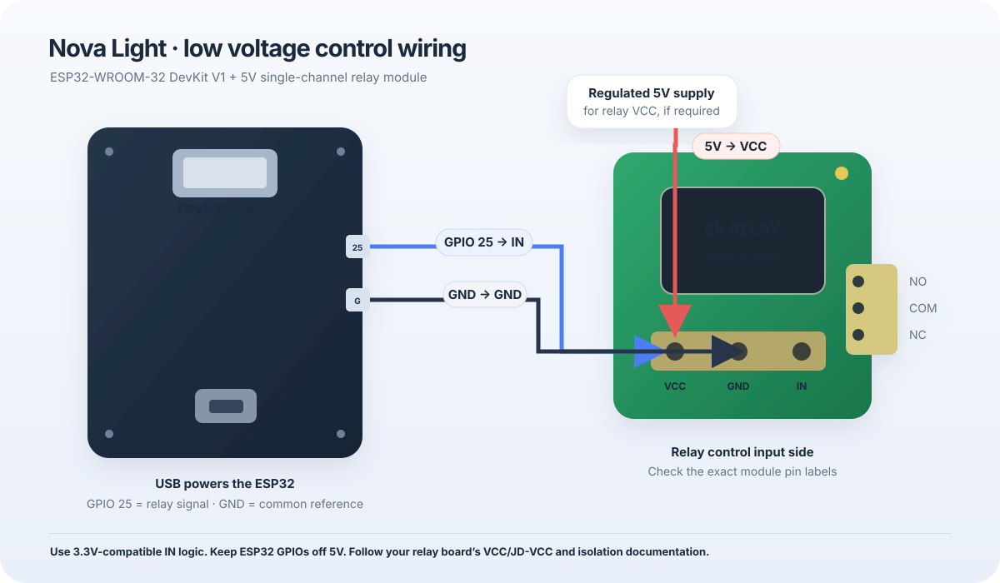

# Nova Light — ESP32 smart-light controller

This workspace had no existing firmware or dashboard files to preserve. This deliverable adds a complete Arduino sketch and a locally hosted web dashboard for the ESP32-WROOM-32 DevKit V1 and a one-channel 5V relay module.

## Project files

- `firmware/NovaLight/NovaLight.ino` — complete firmware, JSON API, schedule, NTP, Wi-Fi reconnect handling, relay output, Preferences storage, and usage/history tracking.
- `firmware/NovaLight/dashboard_html.h` — dashboard embedded in flash for `WebServer` to serve without a filesystem upload.
- `firmware/NovaLight/secrets.example.h` — Wi-Fi credential template; copy it to the ignored local file `secrets.h`.
- `dashboard.html` — readable standalone HTML, CSS, and JavaScript source for the same dashboard.
- `hardware-wiring.svg` — low-voltage control wiring diagram.
- `tools/embed_dashboard.py` — regenerates the embedded header after editing `dashboard.html`.

The firmware uses Arduino `WiFi`, `WebServer`, and `Preferences`; it needs no third-party Arduino libraries, Firebase, Blynk, or external web host. The ESP32 does need Wi-Fi access to an NTP server to obtain time.

## Hardware connections

| ESP32 / supply | Relay module | Notes |
| --- | --- | --- |
| GPIO 25 | `IN` / `SIG` | Relay control signal; firmware configures GPIO 25 as an output. |
| GND | `GND` | Share a ground reference for a non-isolated input arrangement. Follow the module's wiring diagram if it uses `JD-VCC` or opto-isolation jumpers. |
| Regulated 5V | `VCC` | Power the relay coil from a supply capable of the module's required current. Do not connect 5V to an ESP32 GPIO or the ESP32 3V3 pin. |
| ESP32 USB | ESP32 power | Power the DevKit through its USB connector for the initial setup. Avoid tying separate 5V supplies together unless the board/module documentation explicitly permits it. |

The relay input must recognize a 3.3V ESP32 signal. Some 5V relay boards do not; confirm the exact module's input requirements before connecting. GPIO 25 defaults to **active LOW** in the sketch. If the module is active HIGH, edit `RELAY_ACTIVE_LEVEL` in `NovaLight.ino` to `HIGH` and upload again. The firmware sets the inactive output level before enabling the pin and starts with the relay OFF. This software cannot verify that the module's coil, driver, power supply, or contacts work.



The diagram covers only the low-voltage control side and relay terminals. If the contacts will switch mains voltage, use a properly enclosed, correctly rated assembly and have the load wiring installed and checked by a qualified electrician. Do not handle exposed mains wiring while powered.

## Arduino IDE setup

1. Install Arduino IDE 2.x.
2. In Boards Manager, install **esp32 by Espressif Systems**.
3. Open `firmware/NovaLight/NovaLight.ino`. Keep `dashboard_html.h` beside the `.ino` file.
4. Copy `secrets.example.h` to `secrets.h` in the same folder and enter the 2.4 GHz Wi-Fi credentials used at home. The project `.gitignore` excludes `secrets.h`; keep it local and do not commit it.
5. Select **DOIT ESP32 DEVKIT V1** if available, or **ESP32 Dev Module**, and select the serial port for the connected ESP32.
6. Upload. If the upload stalls at “Connecting…”, hold the board's **BOOT** button until writing begins, then release it.
7. Open Serial Monitor at **115200 baud**. When Wi-Fi connects, copy the printed IP address into a browser on the same local network, for example `http://192.168.1.42/`.

The dashboard and API are served directly from the ESP32. No SPIFFS/LittleFS upload is required. The user's browser and ESP32 should be on the same Wi-Fi/LAN; guest-network client isolation can prevent them from reaching each other.

### Editing the dashboard

Edit `dashboard.html`, then from the `NovaLightESP32` folder run:

```text
python tools/embed_dashboard.py
```

This updates `firmware/NovaLight/dashboard_html.h`. Re-upload the sketch to put the changed page on the device. Python is only needed for this regeneration step; it is not needed by the ESP32.

## How the controls work

- The large control toggles the relay immediately and the page refreshes device status every 2.5 seconds.
- Schedule times use minutes after midnight (`0` through `1439`), with an AM/PM display. The default saved times are 6:40 PM ON and 6:40 AM OFF; automatic scheduling starts disabled.
- The schedule supports both same-day intervals and overnight intervals. Equal ON and OFF times are rejected when enabling the schedule.
- Schedule settings, the daily usage total, and the last 10 activity events are stored in ESP32 Preferences and survive a restart. The usage counter rolls over at midnight in Asia/Kolkata and is checkpointed about once per minute and when the relay changes.
- NTP uses `pool.ntp.org` and `time.nist.gov`; the configured time zone is India Standard Time (`IST-5:30`, UTC+5:30). While time has not synchronized, the schedule remains saved but does not operate.
- A manual change remains in effect until the schedule is next evaluated at a minute boundary. If the current time is inside the configured ON window, the schedule then takes control again.
- Light/dark appearance is a browser preference and is stored in that browser's local storage.

## JSON API

All API requests are local to the ESP32. POST bodies are validated as flat JSON objects.

| Method and path | Purpose | Example body |
| --- | --- | --- |
| `GET /api/state` | Connection, relay, schedule, local clock, usage, and activity history | — |
| `POST /api/control` | Set relay state | `{"on":true}` |
| `POST /api/settings` | Save the schedule | `{"scheduleEnabled":true,"onMinute":1120,"offMinute":400}` |

The schedule values in the example are 6:40 PM (`1120`) and 6:40 AM (`400`). Invalid booleans, missing or extra fields, malformed JSON, and out-of-range minutes return a 4xx JSON error.

## Test and troubleshooting checklist

1. **No page / “No response”:** check Serial Monitor for Wi-Fi connection and IP. Confirm the browser is on the same LAN, and try the IP directly rather than a router hostname.
2. **Clock shows “Not synced”:** confirm the ESP32 has Wi-Fi and the router allows outbound DNS/NTP. The web controls still work without NTP; the automatic schedule waits for a valid clock.
3. **Schedule does not switch:** verify the schedule switch is enabled, the ON/OFF times differ, the clock is synced, and the current time is within the ON window. The interval may pass midnight.
4. **Relay does not activate:** verify the module's labeled 5V supply and polarity, common ground where required by its input design, `IN` to GPIO 25, and 3.3V input compatibility. Try `RELAY_ACTIVE_LEVEL HIGH` only if the module documentation specifies active-HIGH control. A lit indicator alone does not establish that the relay coil or contacts are working; software cannot repair a defective or underpowered relay board.
5. **Relay starts in the wrong state:** disconnect the load while checking the module's trigger polarity and boot behavior. The firmware initializes GPIO 25 to its configured inactive level; verify that `RELAY_ACTIVE_LEVEL` matches the board.
6. **Status appears stale:** reload the page and inspect `http://<ESP32-IP>/api/state`. The dashboard polls every 2.5 seconds; reconnects can take several seconds.

Start with the relay contacts unloaded. Confirm GPIO and relay behavior with a low-voltage indicator/load before connecting any mains-powered load.

